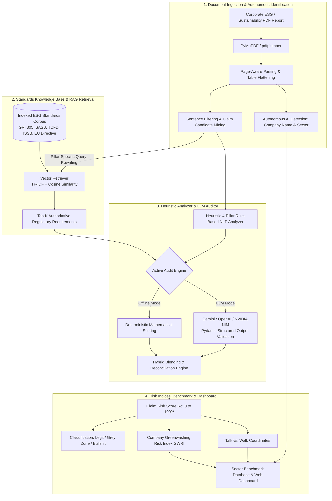

# 🌿 GreenWash-Screener
### Agentic RAG Platform for Corporate ESG Auditing & Multi-Standard Greenwashing Verification

[](https://www.python.org/)
[](https://fastapi.tiangolo.com/)
[](https://developer.mozilla.org/)
[](https://www.globalreporting.org/)
[](https://opensource.org/licenses/MIT)

> **Academic Framework:** Course *Sustainability and ESG Data Analytics*  
> **Institutions:** National Taipei University (NTPU - College of Business) & ESILV Paris  
> **Project Scope:** Autonomous Quantitative Auditing System & Multi-Sector Corporate Benchmark  

---

## 📑 Table of Contents

1. [Executive Summary & Objectives](#-executive-summary--objectives)
2. [System Architecture & RAG Pipeline](#-system-architecture--rag-pipeline)
3. [The 4-Pillar Taxonomy & Quantitative Risk Modeling](#-the-4-pillar-taxonomy--quantitative-risk-modeling)
4. [Step-by-Step Installation & Execution Guide](#-step-by-step-installation--execution-guide)
5. [User Manual: 5 Web Application Modules](#-user-manual-5-web-application-modules)
6. [How to Audit Any Company (Practical Testing Guide)](#-how-to-audit-any-company-practical-testing-guide)
7. [FastAPI REST API Reference](#-fastapi-rest-api-reference)
8. [Project File Structure](#-project-file-structure)
9. [Troubleshooting & Frequently Asked Questions (FAQ)](#-troubleshooting--frequently-asked-questions-faq)

---

## 📌 Executive Summary & Objectives

With the global surge in corporate commitments toward carbon neutrality and ESG compliance, **greenwashing**—the dissemination of unsubstantiated, selective, or misleading environmental claims—has become a major barrier to transparent sustainable investment and regulatory accountability:
- Superficial qualitative buzzwords (*"eco-friendly"*, *"sustainable innovation"*),
- Distant 2050 Net-Zero promises without near-term capital expenditure (CAPEX) or interim milestones,
- Selective reporting that omits critical value chain emissions (**Scope 3**),
- Unverified self-declarations lacking independent third-party assurance.

**GreenWash-Screener** is an end-to-end quantitative auditing solution integrating an intelligent page-aware PDF parser, a vector knowledge base of international sustainability frameworks (**GRI 305, SASB TC-SC, TCFD, ISSB IFRS S1/S2, and EU Directive 2024/825**), and a deterministic 4-pillar risk assessment engine.

### Dual Operating Modalities:
1. **Deterministic Offline Heuristic Mode (Default / 100% Free):** Zero API costs, 100% reproducible, powered by rule-based NLP lexicons, verified regular expressions, and TF-IDF semantic distance retrieval.
2. **Autonomous LLM-Augmented Mode (Agentic AI):** Deep narrative synthesis and contextual claim analysis using **Google Gemini 1.5/2.5**, **OpenAI GPT-4o**, or **NVIDIA NIM**.

---

## 🏗️ System Architecture & RAG Pipeline



### RAG Components:
- **Standards Knowledge Base:** Structured markdown and JSON files located in `data/knowledge_base/esg_standards_kb.md` containing exact requirements:
  - **GRI 305-1 to 305-5:** Direct (Scope 1), energy indirect (Scope 2), and other indirect (Scope 3) greenhouse gas emissions.
  - **SASB TC-SC:** Sector-specific accounting metrics for semiconductors, hardware, and technology.
  - **TCFD Recommendations:** Governance, strategy, risk management, and quantitative metrics & targets.
  - **ISSB (IFRS S1 & S2):** General sustainability and climate-related financial disclosures.
  - **EU Directive 2024/825:** Prohibition of generic environmental claims without recognized excellent performance.
- **Vector Retriever:** Weighted semantic search engine vectorizing claim statements and extracting the 3 most stringent regulatory constraints for cross-examination.

---

## 📐 The 4-Pillar Taxonomy & Quantitative Risk Modeling

Every extracted environmental sentence is evaluated across four core dimensions:

| Pillar | Weight ($w_i$) | High Greenwashing Risk (Bullshit) | Legitimate & Verified Disclosure (Legit) |
| :--- | :---: | :--- | :--- |
| **1. Quantification** | **30%** | Unsubstantiated marketing buzzwords (*"eco-conscious"*, *"green pioneer"*) without figures. | Explicit measurements with recognized scientific units ($tCO_2e$, MWh, %, GJ, $m^3$, intensity ratios). |
| **2. Trajectory & Milestones** | **25%** | Distant targets (*"Net-Zero by 2050"*) with no baseline year, interim milestones, or CAPEX plan. | Clear baseline year, near-term milestones (2025–2030), and third-party validated SBTi targets. |
| **3. Scope & Materiality** | **25%** | Minor initiatives (*"reusable cups at HQ"*) while concealing material Scope 3 value chain emissions. | Full boundary coverage including Scope 1, Scope 2, and material upstream/downstream Scope 3 categories. |
| **4. External Assurance** | **20%** | Self-declared assertions with zero international standard mapping or audit verification. | Standards referenced (e.g., GRI 305-1) with Limited or Reasonable independent third-party audit opinion. |

### Mathematical Formulations:

#### 1. Claim-Level Greenwashing Risk ($R_c$)
$$R_c = w_q \cdot r_{\text{quant}} + w_t \cdot r_{\text{traj}} + w_s \cdot r_{\text{scope}} + w_a \cdot r_{\text{assur}}$$
*where $w = [0.30, 0.25, 0.25, 0.20]$ and each component risk $r_i \in [0, 100]$.*

#### 2. Calibrated Claim Classification
$$\text{Status}(R_c) = \begin{cases} 
\text{🟢 Legit / Verified} & R_c \le 48\% \\ 
\text{🟡 Grey Zone / Incomplete} & 49\% \le R_c \le 74\% \\ 
\text{🔴 High Risk / Bullshit} & R_c \ge 75\% 
\end{cases}$$

#### 3. Company Greenwashing Risk Index (GWRI)
The **Greenwashing Risk Index (GWRI)** combines the weighted average claim risk and the concentration penalty of unsubstantiated claims:
$$\text{GWRI} = \beta \cdot \left(\frac{1}{N}\sum_{c=1}^N R_c\right) + (1 - \beta) \cdot 100 \cdot \left(\frac{N_{\text{bullshit}}}{N}\right)$$
*(with default penalty factor $\beta = 0.80$)*.

#### 4. Strategic "Talk vs. Walk" Matrix
- **Talk Score ($X$):** Frequency and density of promotional buzzwords and unverified marketing assertions.
- **Walk Score ($Y$):** Empirical rigor metric calculated as:
$$\text{Walk} = 0.40 \cdot (100 - r_{\text{quant}}) + 0.30 \cdot (100 - r_{\text{assur}}) + 0.30 \cdot \text{Score}_{\text{Scope 3}}$$

---

## ⚡ Step-by-Step Installation & Execution Guide

### 1. Prerequisites
- **Operating System:** Windows 10/11, macOS, or Linux.
- **Python:** Version **3.10 or higher** installed with `pip`.

### 2. Open Project Directory
Open your terminal (PowerShell on Windows or Bash on Linux/macOS):
```powershell
cd "C:\Users\phone\Documents\ESILV\TAIWAN\Sustainability & ESG\greenwashing_projet"
```

### 3. Create & Activate Virtual Environment
```powershell
# Create virtual environment
python -m venv venv

# Activate on Windows (PowerShell):
.\venv\Scripts\Activate.ps1

# (On Linux / macOS: source venv/bin/activate)
```

### 4. Install Dependencies
```bash
pip install -r requirements.txt
```
*Core packages include: `fastapi`, `uvicorn`, `pydantic`, `pymupdf` (fitz), `pdfplumber`, `scikit-learn`, `requests`, `google-genai`.*

### 5. Configure API Keys (Optional)
The platform operates **100% offline out-of-the-box** without any API key or subscription.  
To enable live LLM generation:
1. Duplicate the template file:
   ```bash
   cp .env.example .env
   ```
2. Insert your credentials:
   ```env
   GEMINI_API_KEY="your-google-gemini-key"
   # or
   OPENAI_API_KEY="your-openai-key"
   # or
   NVIDIA_API_KEY="your-nvidia-nim-key"
   ```

### 6. Launch the Web Application
Run the FastAPI production server:
```powershell
python server.py
```
*Or directly with Uvicorn:*
```powershell
uvicorn server:app --host 127.0.0.1 --port 8000 --reload
```

Open your browser at:  
👉 **`http://127.0.0.1:8000`**

*(Note: The legacy Streamlit interface remains accessible via `streamlit run app.py` on port 8501).*

---

## 🖥️ User Manual: 5 Web Application Modules

The user interface features 5 specialized executive tabs:

```
[ 📄 Single-Company Screener ] [ 🏆 Sector Benchmark ] [ ⚡ Live RAG Tester ] [ 📚 Standards & Taxonomy ] [ 🎓 Academic Overview ]
```

---

### Tab 1: 📄 Single-Company Screener & PDF Auditor
Conducts deep forensic audits of corporate sustainability reports.

1. **Document Loading:**
   - **One-Click Official Sample:** Click **"🚀 Run Apple 2024 Audit"** to audit the bundled official Apple Environmental Progress Report 2024.
   - **Drag & Drop / Browse:** Drop any corporate ESG PDF into the upload zone.
2. **Autonomous AI Configuration:**
   - **Company Name:** Leave blank for automatic AI detection.
   - **Industry Sector:** Set to **"🤖 Autonomous AI Detection (Auto-detect)"** by default. The system analyzes cover pages to accurately assign sectors (*Consumer Hardware & Tech*, *Automotive & Mobility*, *Energy & Utilities*, *Semiconductors*, etc.).
   - **Persistence:** Leave *"💾 Automatically save to Sector Benchmark"* checked to include the audited company in the comparative benchmark.
   - Click **"🚀 Run Agentic RAG ESG Audit on PDF"**.
3. **Audit Analytics Output:**
   - **Global GWRI Gauge:** Dynamic risk needle from 0 to 100% (*Verified Low Risk*, *Grey Zone*, *High Greenwashing Risk*).
   - **Executive KPI Cards:** Total claims audited, % Legit, % Bullshit, and Scope 3 completeness ratio.
   - **Interactive Claim Filters:** Filter claims by badge (*All*, *🟢 Legit*, *🟡 Grey Zone*, *🔴 Bullshit*).
   - **Smooth 5-per-page Pagination:** Page-by-page navigation with bounded Previous/Next buttons.
   - **Claim Forensic Breakdown:**
     - Original sentence and verified page number,
     - 4-pillar risk score breakdown (Quantification, Roadmap, Scope, Assurance),
     - Matched international ESG standard code (e.g., *GRI 305-1*, *SASB TC-SC-110a.1*, *IFRS S2*),
     - Detailed auditor justification and regulatory cross-examination.

---

### Tab 2: 🏆 Multi-Sector Corporate Benchmark
Enables sector-wide comparative benchmarking across audited corporations.

1. **Sector Filtering Toolbar:**
   - Filter by **"All Sectors"** or isolate a specific industry (*Consumer Hardware & Tech*, *Semiconductors & Electronics*, etc.).
   - Dynamic counter displaying the number of active companies in the selected sector.
2. **Leaderboard Bar Chart:**
   - Ranks companies by ascending Greenwashing Risk Index.
3. **4-Pillar Radar Comparison:**
   - Multi-company polygon comparing structural disclosure balances across Quantification, Roadmap, Scope, and Assurance.
4. **Strategic "Talk vs. Walk" Matrix:**
   - 4-Quadrant scatter plot contrasting marketing volume (Talk) against verified physical rigor (Walk).
5. **Sector Summary Table:**
   - Displays Company Name, Sector, Ticker, GWRI Score, Legit Ratio, Scope 3 completeness, and Assurance status.
   - Interactive `👁️ View` button to load any company's full audit, and `🗑️` button to delete custom uploads.

---

### Tab 3: ⚡ Live RAG Claim Tester
Dissects individual corporate statements in real time.

1. Type or paste any environmental claim, for example:
   > *"We achieved 100% renewable electricity across all operations and aim to reach Net-Zero carbon emissions by 2030."*
2. Click **"🔎 Audit Claim with Agentic RAG"**.
3. Instantly view:
   - Retrieved ESG standards and regulatory clauses,
   - Quantitative risk breakdown across the 4 pillars,
   - Clear classification badge and auditor justification.

---

### Tab 4: 📚 Standards & Taxonomy
Reference ontology explaining the regulatory corpus:
- Exact criteria for **GRI 305**, **SASB TC-SC**, **TCFD**, **ISSB IFRS S2**, and **EU Directive 2024/825**.
- Searchable regulatory passage index with real-time text filter.

---

### Tab 5: 🎓 Academic Project Overview
Summarizes project objectives, methodological foundations, scoring formulas, and academic context.

---

## 🔍 How to Audit Any Company (Practical Testing Guide)

To audit any company of your choice (e.g., **Tesla, Microsoft, L'Oréal, TotalEnergies, TSMC**):

### 1. Where to download reports?
Visit the official **"Investor Relations"** or **"Sustainability / ESG"** section of the company's website and download their latest annual publication:
- *Sustainability Report*, *Universal Registration Document (URD)*, *Climate Progress Report*, or *ESG Data Book*.

### 2. Which sections yield the best results?
Corporate sustainability reports often span 80 to 200 pages. For optimal auditing:
- **Climate & Decarbonization Sections:** Pages containing greenhouse gas inventories (**GHG Accounting**).
- **Scope 1, 2, and 3 Disclosures:** Tables detailing direct fuel emissions, electricity consumption, and value chain categories.
- **Net-Zero Transition Roadmaps:** Sections titled *"Roadmap to 2030/2050"*, *"SBTi Validated Targets"*, *"Renewable Energy Commitments"*.
- **Independent Assurance Report:** The concluding letter signed by an accredited auditor (e.g., PwC, EY, KPMG, Bureau Veritas) confirming limited or reasonable assurance.

---

## 🔌 FastAPI REST API Reference

The server exposes an interactive Swagger documentation page at **`http://127.0.0.1:8000/docs`**:

| Method | Endpoint | Description | Parameters / Payload |
| :--- | :--- | :--- | :--- |
| `GET` | `/api/health` | Health check endpoint | None |
| `GET` | `/api/providers` | List available LLM providers & environment key status | None |
| `GET` | `/api/benchmark` | Retrieve benchmark dataset with sector filtering | Optional query: `?sector=...` |
| `GET` | `/api/benchmark/companies/{name}` | Retrieve single company audit details | Company name |
| `POST` | `/api/benchmark/save` | Persist an audited company into the benchmark database | Complete company JSON body |
| `DELETE` | `/api/benchmark/companies/{name}` | Remove a custom company from the benchmark | Company name |
| `GET` | `/api/sample-apple` | Run 1-click audit on official Apple 2024 PDF sample | None |
| `POST` | `/api/audit/claim` | Dissect a single environmental claim | `{"text": "...", "provider": "mock"}` |
| `POST` | `/api/audit/pdf` | Upload and audit sustainability report PDF | `multipart/form-data (file, company_name, sector, max_claims, auto_save)` |
| `GET` | `/api/taxonomy` | Retrieve the 4 Pillars Greenwashing Taxonomy | None |
| `GET` | `/api/standards` | List indexed regulatory ESG standards chunks | None |

---

## 📂 Project File Structure

```text
greenwashing_projet/
├── server.py                       # FastAPI REST API Server & static web asset provider
├── app.py                          # Streamlit application (Alternative backup interface)
├── requirements.txt                # Python dependencies
├── .env.example                    # Template for API keys (Gemini, OpenAI, NVIDIA NIM)
├── README.md                       # Comprehensive User Manual & Technical Documentation
│
├── frontend/                       # Modern Web Dashboard (HTML5 / Vanilla CSS3 / JS)
│   ├── index.html                  # Semantic single-page application structure (5 tabs)
│   ├── index.css                   # Responsive dark-mode styling, glassmorphism, design tokens
│   └── app.js                      # Asynchronous API controller, Chart.js integrations, pagination
│
├── data/
│   ├── knowledge_base/             # Vector RAG Standards Corpus
│   │   ├── esg_standards_kb.md     # Authoritative rules: GRI 305, SASB, TCFD, ISSB, EU Directive
│   │   └── greenwashing_taxonomy.json # 4-Pillar taxonomy lexicons and regular expressions
│   └── sample_reports/             # Benchmark datasets and persistent records
│       ├── semiconductor_esg_benchmark.json # Baseline records for tech leaders
│       ├── custom_companies.json   # Persistent storage for newly audited user companies
│       └── apple_environmental_progress_report_2024_sample.pdf # Certified Apple 2024 sample
│
└── src/                            # Core Algorithmic Engine
    ├── __init__.py
    ├── pdf_processor.py            # Page-aware text extractor, cleaner & candidate claim miner
    ├── rag_engine.py               # Vector knowledge base chunking & TF-IDF similarity retriever
    ├── scoring_engine.py           # Deterministic 4-pillar scoring, heuristic NLP & GWRI modeling
    └── agent_screener.py           # Multi-provider LLM agent, Pydantic validation & auto-detection
```

---

## 🚀 Pushing to GitHub & Deploying to Render.com

### 1. Push your Project to GitHub
Initialize your Git repository and push to your GitHub account:
```powershell
# In the project directory
git init
git add .
git commit -m "feat: complete GreenWash-Screener platform ready for deployment"

# Connect to your GitHub repository (replace with your repo URL)
git branch -M main
git remote add origin https://github.com/YOUR_USERNAME/YOUR_REPOSITORY.git
git push -u origin main
```
> **Security Note:** Your private API keys in `.env` are automatically ignored by `.gitignore` and will never be pushed to GitHub.

---

### 2. Deploy on Render.com (100% Free Web Service)
1. Go to [render.com](https://render.com) and create or log in to your account.
2. Click **New +** > **Web Service**.
3. Select your newly pushed GitHub repository.
4. Render will auto-detect `render.yaml` or you can verify:
   - **Environment**: `Python 3`
   - **Build Command**: `pip install -r requirements.txt`
   - **Start Command**: `uvicorn server:app --host 0.0.0.0 --port $PORT`
   - **Plan**: `Free`
5. In **Environment Variables**, add:
   - `GEMINI_API_KEY`: *(Your Google AI Studio API key)*
6. Click **Create Web Service**. Within 2 minutes, your project is live with an HTTPS link like `https://greenwash-screener.onrender.com`!

---

### 3. Why JSON Storage instead of PostgreSQL?
- **Zero Configuration & Maintenance**: Benchmark reports and user audits are saved to `data/sample_reports/custom_companies.json`.
- **Permanent & Free**: Render's free tier PostgreSQL databases expire or go to sleep after 30 days. JSON files are stored with your project and work indefinitely with zero external dependencies.
- **Git Versioned**: Your benchmark records can be versioned and committed alongside your project.

---

## ❓ Troubleshooting & Frequently Asked Questions (FAQ)

### 1. Port 8000 already in use?
If you encounter `[Errno 10048] address already in use`, specify an alternate port:
```powershell
uvicorn server:app --host 127.0.0.1 --port 8080 --reload
```
Then navigate to `http://127.0.0.1:8080`.

### 2. Is a paid API key required?
**No.** The default `Mock Offline Fallback` operates 100% locally and free of charge, using deterministic NLP rules calibrated directly against official ESG standards.

### 3. Why are no claims extracted from a scanned PDF?
The system utilizes native text-layer extraction via `PyMuPDF`. If a PDF consists solely of scanned bitmap images without OCR (Optical Character Recognition), text cannot be parsed directly. Please use official vector PDFs published directly by companies.

---

## 👥 Authors & Academic Citation

Developed for the **Sustainability and ESG Data Analytics** curriculum at **National Taipei University (NTPU)** and **ESILV Paris**.

```bibtex
@misc{greenwash_screener_2026,
  title={GreenWash-Screener: Agentic RAG Platform for Corporate ESG Auditing and Multi-Standard Greenwashing Verification},
  author={NTPU & ESILV Sustainability Analytics Team},
  year={2026},
  note={Sustainability and ESG Data Analytics Course Project}
}
```
